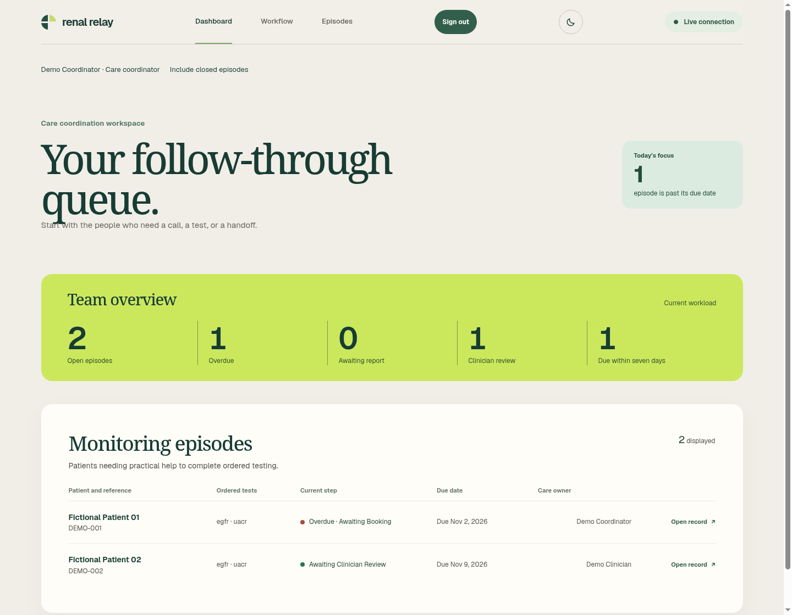
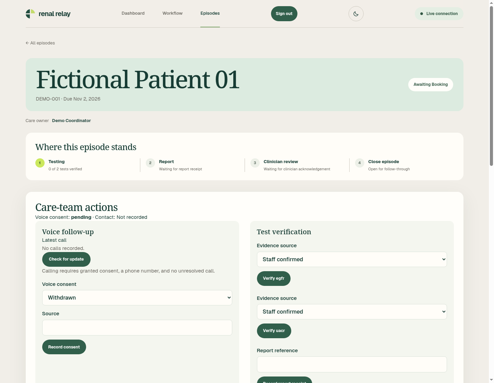
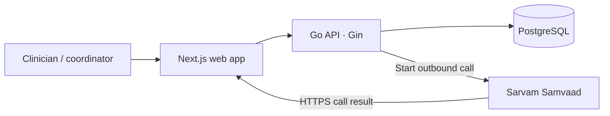

# Renal Relay


**Health-a-thon 2026 · Final prototype**

**Team** Cephalic Labs · **Doctor partner** Dr. Pradeep Jeyakumar

Ordering kidney monitoring is the first step. Between visits, care teams still need to know whether the patient could arrange testing, whether each test was verified, and whether the clinician reviewed the report. **Renal Relay** gives clinicians and coordinators a shared workspace to follow uACR and eGFR orders for people with diabetes through to a documented next action.

## Submission links

- [Source repository](https://github.com/cephalic-labs/nephrosa)
- [Live deployment](https://nephrosa.saumyajit.dev/)
- [Demo video folder on Google Drive](https://drive.google.com/drive/folders/1L1zb6LXjkC8oBcb8w9d3H9KO6zKoMNb3)

## Screenshots





> Hosted demo credentials for the clinician and coordinator roles are in the submission form and are omitted here to prevent abuse.

## From order to clinician review

| Step                                                   | What happens                                                                                                                                                                                                 |
| ------------------------------------------------------ | ------------------------------------------------------------------------------------------------------------------------------------------------------------------------------------------------------------ |
| **1. Clinician orders monitoring**                     | Create an episode, select uACR and/or eGFR, set a due date, assign a care owner, and record voice consent and its source.                                                                                    |
| **2. Care team starts voice follow-up**                | Sarvam Samvaad calls the number saved on the episode. The callback records the call result and any patient response summary. The episode page checks for updates automatically while the call is unresolved. |
| **3. Coordinator follows up**                          | Review the outcome and follow-up task. Record resolutions for tasks and barriers. A request for a callback becomes work for the care team. A patient opt-out withdraws voice consent and blocks new calls.   |
| **4. Care team verifies tests and records the report** | Record evidence for each ordered test and then enter the report reference. A patient saying they completed a test does not count as staff verification.                                                      |
| **5. Clinician reviews and closes**                    | Acknowledge the report and document the next action. The API blocks closure until every test is verified, the report and review are recorded, and outstanding tasks, barriers, and calls are resolved.       |

Role-based dashboards show open and closed episodes. Episode history includes contact attempts, workflow records, and an append-only audit trail. The API blocks duplicate unresolved calls and handles repeated terminal callbacks without creating duplicate work.

**Multilingual calling.** Cephalic Labs verified multilingual conversations in the prototype’s voice follow-up workflow. Renal Relay starts calls in English, and the configured Samvaad agent can switch languages during the call. The app currently records English in contact history. [Sarvam language settings](https://docs.sarvam.ai/voice-agents/build/conversation-settings)

## Architecture



The frontend uses Next.js 16, React 19, TypeScript, and CSS. The Go API uses Gin and pgx for PostgreSQL. Next.js keeps the staff session in an HTTP-only cookie, calls Go server-side, and forwards the specific Sarvam callback route. The [Docker Compose deployment](deploy/demo.md) publishes the web port and keeps Go and PostgreSQL on the Compose network.

## Run locally

Use **Node.js 24**, **pnpm 12.10.1**, **Docker Engine with Compose 2.24.4+**, and **OpenSSL**. Install **Go 1.26+** for backend tests, **Python 3** for the voice configuration check, and **Make** if using the deployment targets.

From a fresh checkout, run the following at the repository root.

```sh
pnpm install --frozen-lockfile
./scripts/dev-secrets.sh
docker compose --env-file .env -f deploy/compose.yaml up -d --build db api
docker compose --env-file .env -f deploy/compose.yaml --profile dev-seed run --rm seed
pnpm dev
```

Open [localhost:3000/login](http://localhost:3000/login). Compose initializes PostgreSQL, creates the app and migration roles, and applies the schema before starting Go. The seed creates fictional episodes and local clinician and coordinator accounts. Use the credentials generated under `secrets/` for your local copy. The setup script creates `.env` from [the environment template](.env.example) and refuses to overwrite an existing secrets directory.

Keep `APP_ENV=development` for seeding. The local frontend uses `RELAY_API_URL=http://127.0.0.1:8080`. If you change `API_PORT`, update `RELAY_API_URL` too, including in `.env.local` if that file overrides it. The database uses a named volume. Keep it and its credentials together. [Local development guide](docs/guides/local-development.md)

### Configure Sarvam Samvaad

Use a workspace API key, a committed agent version, and an outbound telephony connection. Configure agent inputs `patient_name`, `due_date`, and `episode_reference`, and outputs `outcome` and `follow_up_note`. The [Samvaad runbook](docs/guides/samvaad-demo.md) specifies the allowed outcomes, agent instructions, and recovery steps.

Set the following in the root `.env`, replacing each placeholder. Put the workspace key in `secrets/sarvam_api_key` with mode `600`.

```dotenv
SARVAM_API_BASE_URL=https://apps.sarvam.ai
SARVAM_ORG_ID=<organization-id>
SARVAM_WORKSPACE_ID=<workspace-id>
SARVAM_APP_ID=<agent-app-id>
SARVAM_APP_VERSION=<committed-numeric-version>
SARVAM_CONNECTION_ID=<outbound-connection-id>
SARVAM_AGENT_PHONE_NUMBER=<agent-number-in-E.164>
DEMO_CALL_PHONE_NUMBER=<consenting-demonstrator-number-in-E.164>
SARVAM_WEBHOOK_URL=https://demo.example.org/api/v1/sarvam/webhooks
SARVAM_WEBHOOK_ENABLED=false
```

Point a public HTTPS proxy or tunnel at the Next.js app so the callback path can reach Go. Each call gets a secret URL. Verify routing and exclude callback paths and bodies from logs and analytics, then set `SARVAM_WEBHOOK_ENABLED=true` to enable calling and callbacks. The preflight checks local configuration without placing a call. Recreate the API after changing the settings or key.

```sh
python3 scripts/demo-preflight.py
docker compose --env-file .env -f deploy/compose.yaml up -d --force-recreate api
```

## Demo walkthrough

1. As the **clinician**, create a new `DEMO-<unique-reference>` episode with a fictional patient, both tests, a due date, a coordinator, and recorded voice consent. Enter the consenting demonstrator’s number in the form. The preflight setting does not populate it.
2. As the **coordinator**, open that episode and select **Call patient**. Have the demonstrator ask for a human callback. Leave the episode open and show the outcome, **Patient response summary**, and follow-up task when they arrive.
3. Resolve the task and any open barrier, verify both tests with an evidence source, and record a fictional report reference.
4. Return as the **clinician**, acknowledge the report, record the next action, and close the episode. Use **Include closed episodes** to find the record and its audit history.

## Checks and deployment

```sh
curl -fsS http://127.0.0.1:8080/health/live
curl -fsS http://127.0.0.1:8080/health/ready
go test ./...
pnpm lint
pnpm build
```

Set `TEST_DATABASE_URL` to a disposable PostgreSQL database with a role that can create schemas to include the database and simulated callback integration test. Without it, Go skips that test. The test creates and drops its own schema.

For the single-instance setup, use `make up`, `make seed`, and `make status` with the [deployment guide](deploy/demo.md). The deployed frontend requires HTTPS for staff sign-in. The [Samvaad runbook](docs/guides/samvaad-demo.md#verified-demonstration) records the earlier live calling and callback rehearsals.

## Safety and limitations

Use fictional clinical records and a consenting demonstration phone. The voice agent gathers practical follow-up information. It does not diagnose, interpret results, or recommend treatment. Staff verify testing and report receipt. Clinicians make clinical decisions and authorize closure. The app stores structured outcomes and short patient summaries, with orders and report references entered manually. This prototype has no demonstrated clinical outcomes.
